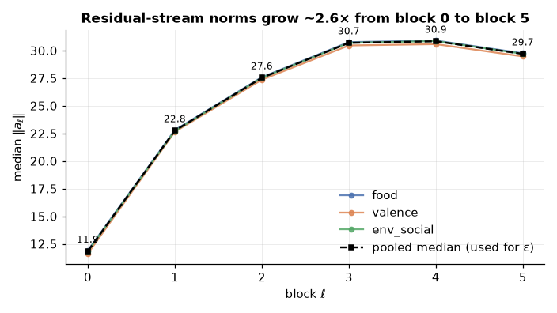
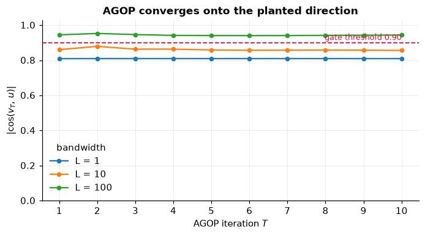
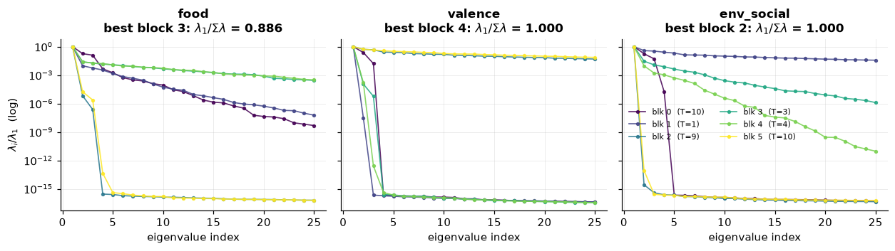
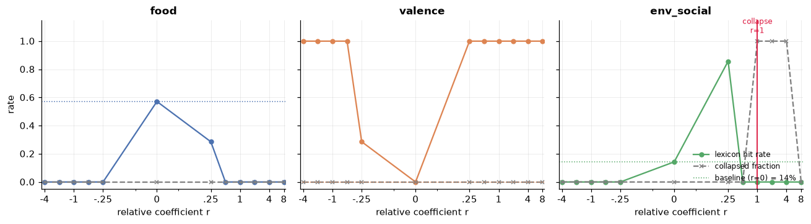
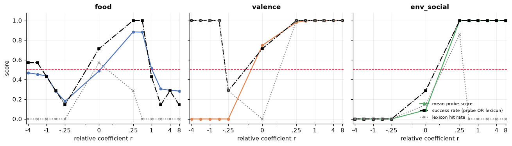
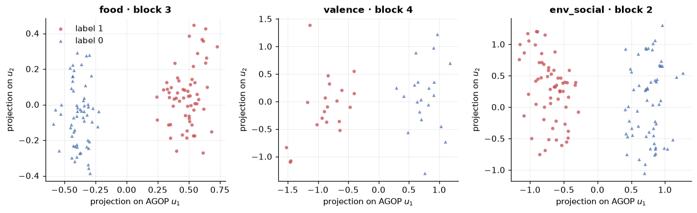
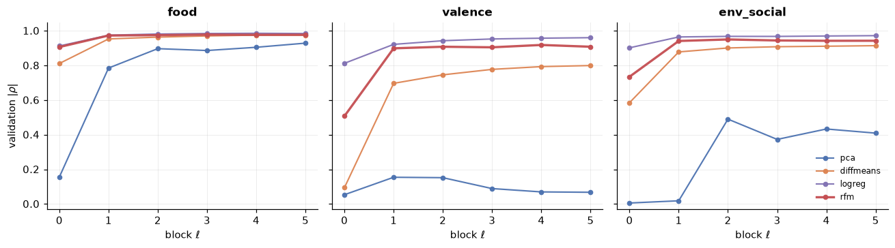

# Steering a Fish: Replicating *Universal Steering and Monitoring of AI Models* on an 8.7M-Parameter Language Model

*By Leonardo Valadão*

---

## Index

1. [Summary](#1-summary)
2. [Original Paper Fundamentals](#2-original-paper-fundamentals)
3. [What is GuppyLM?](#3-what-is-guppylm)
4. [Replication](#4-replication)
5. [Findings vs. the Paper](#5-findings-vs-the-paper)
6. [Honest Limitations](#6-honest-limitations)
7. [Next Steps](#7-next-steps)
8. [Reproducing this work](#8-reproducing-this-work)

---

## 1. Summary

[Beaglehole, Radhakrishnan, Boix-Adserà & Belkin (2025), *Toward Universal Steering and Monitoring of AI Models*](https://arxiv.org/abs/2502.03708) makes a strong claim: the concepts a language model "knows" are stored as **linear directions** in its activation space, those directions can be **extracted with a feature-learning algorithm** (the Recursive Feature Machine, RFM), and once you have them you can both **steer** the model (push its generations toward or away from a concept by adding a vector to the residual stream) and **monitor** it (detect whether a concept is active by reading the activations). On Llama-class models (8B–90B) the paper uses this to expose jailbreaks, impose political stances, suppress deception, transfer concepts across languages, and build hallucination/toxicity monitors that beat GPT-4o judges.

Those headline results live at the 70-billion-parameter scale. The natural question for anyone who wants to *understand* the method rather than just admire it is: **does the machinery itself work, or does it depend on the model being huge?**

This post documents a controlled replication of the paper's **mechanism** — RFM extraction, additive steering, AGOP-eigenvector probing, and the four-way baseline comparison — on **GuppyLM**, a ~8.7M-parameter fish-themed chatbot. That is roughly **8,000× smaller** than Llama-3.3-70B. We deliberately drop the safety/scaling/transfer claims (a 4,096-token fish model has no representation of "anti-refusal" or Chinese) and instead ask the clean question:

> *Does linear concept extraction + additive steering + activation probing hold at <10M parameters, restricted to concepts the model actually represents — its own training categories?*

**Short answer: the reading half of the method transfers intact; the writing half transfers as a mechanism but not as a capability; and the comparison against baselines never gets tested at all.** More precisely, in three parts:

1. **Extraction and monitoring hold cleanly.** RFM recovers a concept direction per block from `(prompt, label)` pairs alone, and a probe built on 18 numbers per prompt reaches **AUROC = 1.000** on held-out data. That is a ceiling, and it is reported as one.
2. **Steering is causal but crude.** Adding `ε·v_ℓ` to every block demonstrably drags the output vocabulary toward the concept — but at every coefficient tested, fluency degrades badly. The direction is real; controlled steering is not achieved at this scale.
3. **The RFM-over-baselines claim is not testable here.** RFM beats PCA clearly. It ties difference-in-means and logistic regression at the ceiling — and the steering half of that comparison turns out to be a **broken measurement**, not a tie. This is exactly what the paper's own reasoning predicts for easy, in-domain concepts.

Everything below is backed by four executed notebooks in [`notebooks/`](notebooks/), which recompute the cheap parts live and assert that they reproduce the committed artifacts.

---

## 2. Original Paper Fundamentals

The paper's pipeline has three stages, all built on one primitive: a per-block, per-concept **concept vector**.

### Setup and notation

A transformer LM is a composition of `L` blocks. For an input prompt `X`, block `ℓ` emits activations `A_ℓ(X) ∈ R^{t×k}` (sequence length `t`, hidden dimension `k`). Following the paper, the feature for a prompt is the **last real (non-pad) token row** of each block's output, `a_ℓ ∈ R^k`. You collect `n` labeled prompts `{X^(i), y^(i)}` with `y ∈ {0,1}` (1 = concept present), run them through the model, and stack the per-block last-token activations into `Z_ℓ = [a_ℓ^(1), …, a_ℓ^(n)] ∈ R^{n×k}`. Everything below is done **independently per block**.

Crucially, steering data needs **no text outputs** — only `(prompt, label)` pairs — which is what makes the data collection cheap (the paper steers a concept in under a minute with <500 samples on one A100).

### 1. RFM: extracting the concept vector

The Recursive Feature Machine (Radhakrishnan et al., *Science* 2024) is, informally, a **supervised, nonlinear generalization of PCA**. It learns which directions in input space the predictive function actually depends on, via the **Average Gradient Outer Product (AGOP)**.

The predictor is kernel ridge regression with a **Mahalanobis–Laplace kernel** parameterized by a PSD matrix `M` and bandwidth `L`:

```
K_M(x, z) = exp( −(1/L) · sqrt( (x − z)ᵀ M (x − z) ) )
```

Initialize `M₀ = I`. For `t = 0 … T−1`:

- **Step 1 — Kernel ridge regression.** Fit `α_t = y · [K_{M_t}(Z, Z) + λI]⁻¹`, giving the predictor `f_t(z) = α_t · K_{M_t}(Z, z)`.
- **Step 2 — AGOP.** Recompute `M` as the average outer product of the predictor's input-gradients over the training points:

```
M_{t+1} = (1/n) · Σ_i ∇_z f_t(a^(i)) ∇_z f_t(a^(i))ᵀ
```

After `T` iterations, the **concept vector `v` is the top eigenvector of `M_T`**. It is **oriented** by computing the Pearson correlation `ρ` between projections `{⟨a^(i), v⟩}` and labels `{y^(i)}`, and taking `sign(ρ) · v` so that positive projection means "more concept."

The gradient that drives the AGOP, for `d_i(z) = sqrt((z − a^(i))ᵀ M (z − a^(i)))`, is:

```
∇_z f_t(z) = Σ_i α_i · K_M(a^(i), z) · (−1/L) · (1/d_i(z)) · M (z − a^(i))
```

(with the `d_i = 0` term zeroed out). Typical hyperparameters: `λ = 10⁻³`, `L ∈ {1, 10, 100}`, `T ≤ 10`.

Why RFM and not just logistic regression? Because the AGOP captures the directions a *nonlinear* predictor is sensitive to, RFM can surface concept structure that a single linear separator misses — the paper's claim is that this matters for hard, abstract concepts and large models. Hold on to that conditional; it decides the outcome of the last section.

### 2. Steering: additive perturbation of the residual stream

Given per-block concept vectors `{v_ℓ}`, you steer during the forward pass by adding `ε·v_ℓ` to **every token row** of block `ℓ`'s output:

```
Ã_ℓ,i(X) = A_ℓ,i(X) + ε·v_ℓ ,  for all token positions i
```

`ε` is the **control coefficient**. `ε > 0` steers toward the concept; `ε < 0` away from it (this is how the paper makes DeepSeek *more honest* — it subtracts the deception vector). **Multi-concept steering** is just steering with a linear combination of vectors. The paper also reports two emergent properties: concept vectors learned on English transfer to other languages, and vectors for different concepts compose.

### 3. Monitoring: probing the AGOP eigenbasis

For monitoring, instead of the single top eigenvector you keep the **top `p` eigenvectors** `{v_{ℓ,j}}` per block. The feature for prompt `i` is the set of projections `⟨a_ℓ^(i), v_{ℓ,j}⟩` over all blocks `ℓ` and components `j` — a vector in `R^{(L−1)p}`. You then train a classifier under one of two strategies: **(1) per-block**, train one classifier per block and keep the best, or **(2) aggregate**, concatenate all blocks and train a single classifier. Evaluation is by **AUROC**. The paper's striking monitoring result is that these activation-probe classifiers, built on *smaller* open models, beat *direct-judge* models like GPT-4o on hallucination and toxicity benchmarks.

### 4. Baselines

RFM is compared against three cheaper extraction methods, all oriented by the same Pearson-sign rule:

- **PCA** — top eigenvector of the (paired) pos-minus-neg difference matrix.
- **Difference-in-means** — `v = mean(S₁) − mean(S₀)`.
- **Logistic regression** — the normalized LR coefficient vector.

The paper's quantitative story is that RFM matches or beats these, and the gap widens on harder concepts and larger models.

---

## 3. What is GuppyLM?

[GuppyLM](https://github.com/arman-bd/guppylm) is a deliberately tiny, fully open, character-driven language model: a chatbot that role-plays as a small, opinionated pet fish. It is an ideal *mechanism testbed* precisely because it is small enough to be fully controllable and inspectable, yet it is a real instruction-tuned transformer with a real residual stream.

| Property | Value |
|---|---|
| Parameters | ~8.73M |
| Transformer blocks | 6 (`model.blocks[0..5]`) |
| Hidden dimension `k` | 384 |
| Vocab capacity | 4,096 (~2,418 active BPE tokens) |
| Prompt format | ChatML (`<|im_start|>user … <|im_end|>` …) |
| Training data | [`arman-bd/guppylm-60k-generic`](https://huggingface.co/datasets/arman-bd/guppylm-60k-generic) — ~60k rows over 60 categories |

Each block outputs a residual-stream tensor of shape `[B, T, 384]`, which is exactly the object the paper's method reads from and writes to. The model is trained on 60 templated conversational categories (food, weather, greetings, tank conditions, moods, …). Those categories are the *only* concepts GuppyLM can plausibly represent — so they become our concepts. We do **not** try to steer it toward jailbreaks, political stances, or other languages; it has no such representations, and pretending otherwise would just be measuring noise.

One useful consequence of GuppyLM's scale: its per-block activation norms are tiny, known, and **grow roughly three-fold across depth**. A perturbation that is a nudge at block 5 is a wrecking ball at block 0 — which is why the paper's absolute steering coefficients cannot be copied over.



*The three concepts agree almost exactly, so the pooled median (dashed) is a safe scale to normalise by. Everything in the steering section is expressed relative to this curve.*

---

## 4. Replication

The replication is organized as a package (`rfm_guppy/`), four experiment scripts, and four executed notebooks that mirror them, run phase by phase with **pre-declared acceptance criteria** gating each step — written before any code and frozen since ([`plans/GUPPYLM_GUIDE.md`](plans/GUPPYLM_GUIDE.md)), with the per-phase execution notes kept separately ([`plans/phase_plans/`](plans/phase_plans/)) so intent and outcome can be read against each other.

### Scope decisions

**In scope:** RFM extraction, additive steering, AGOP-eigenvector probing, four-way baseline comparison. **Out of scope (and why):** anti-refusal/jailbreaks, deception, political stances (no such representations), cross-language/coding/reasoning transfer (absent capabilities), hallucination/toxicity benchmarks (the tokenizer can't even encode them), and the scaling claim (needs a model ladder — that's a separate Pythia plan). A weak or negative result on any in-scope mechanism is reported as a finding, not tuned away. As it happens, most of the interesting content below is of exactly that kind.

### Activation harness

We register `forward_hook`s on each of the 6 blocks, capture each block's output `[B, T, 384]`, and extract the **last non-pad token row** per prompt, yielding `A ∈ R^{n × 6 × 384}`. The harness is checked for determinism (`model.eval()`, no dropout → bit-identical activations for identical prompts) and **padding invariance** (a prompt's activation is independent of right-padding length, verified to 7×10⁻⁷, i.e. float32 noise — a wrong attention mask here silently corrupts everything downstream).

### Concept datasets

Because raw GuppyLM user inputs are heavily templated (only ~4–34 unique strings per category), we use **full ChatML exchanges** (user + model response) as prompts, which yields hundreds of diverse texts per category. We built three binary concepts as category contrasts:

| Concept | Positive categories | Negative categories | N/class |
|---|---|---|---|
| **food** | food, taste | weather, seasons, tv, music, glass, rain, outside | 300 |
| **valence** | happy, excited, love, curious | scared, fear, bored, tired | 100 |
| **env_social** | water, filter, temp_hot, temp_cold, algae | greeting, bye, friends, visitors, lonely | 300 |

Each is class-balanced and split 60/20/20 (train/val/test) on unique exchange strings, with prompt-leakage across splits explicitly verified (asserted at build time, and zero by construction).

### RFM implementation and the synthetic gate

The RFM core (`laplace_kernel`, `rfm_fit`, `agop_grad`, `top_eigvectors`, `orient`, `extract_concept_vector`) implements §1 exactly: mean-centered inputs, vectorized AGOP gradients with the `d_i = 0` guard, `eigh` on the 384×384 PSD matrix, and HP selection by maximum validation `|Pearson|` over `L ∈ {1,10,100}`, `T ∈ {1..10}`, `normalize ∈ {False, True}`. The naive `[n,n,k]` gradient (≈400 MB) is rewritten as `G = −(W_sum⊙Z_c − W·Z_c)·M`, and the `T` sweep runs incrementally — iteration `T+1` continues from iteration `T`'s `M` — so 60 settings per block take about a second.

Before trusting anything on real data, we **gate on a synthetic recovery test**: generate `n=1000`, `k=384` standard-normal data with labels `y_i = ⟨z_i, u⟩` for a hidden unit direction `u`, and confirm RFM's top eigenvector aligns with `u`. (The labels are real-valued rather than thresholded on purpose: recovering a direction in `R^384` from 800 points is a question about the AGOP machinery, and sign labels throw away most of the information about `u` unless `n ≫ k`.)

> **|cos(v, u)| = 0.9528** (threshold 0.90) — **PASSED** ✓
> Best HP: `L=100, T=2, normalize=False`, val `|ρ| = 0.954`, `λ₁/Σλ = 0.966`.

There is a detail here worth more than the pass/fail. Unrolling the AGOP loop by hand shows the convergence curve is **flat**:



*`L = 100` clears the gate on its very first iteration (0.945) and the next nine change nothing; the smaller bandwidths plateau below threshold and never climb out.*

On this problem the AGOP re-weighting is not what finds the direction. The first iteration starts from `M = I` — an ordinary Laplace kernel — and since `y` is exactly linear in `⟨z, u⟩`, a plain kernel at the right bandwidth already solves it. What the sweep buys on the synthetic gate is the **bandwidth**, not the iteration count, which is precisely why `L` is swept rather than borrowed from the paper. Iteration earns its keep on the real activations, where it visibly drives `M` toward rank 1 — a different job from finding the direction in the first place.

Only after this gate passes do we touch real concepts.

### Concept-vector extraction

Running RFM per block per concept gives strong linear separability everywhere except the earliest block:

**Validation `|Pearson|` (RFM), per block:**

| Block | food | valence | env_social |
|---|---|---|---|
| 0 | 0.906 | 0.507 | 0.735 |
| 1 | 0.973 | 0.899 | 0.941 |
| 2 | 0.975 | 0.908 | **0.950** |
| 3 | **0.978** | 0.905 | 0.944 |
| 4 | 0.977 | **0.918** | 0.942 |
| 5 | 0.977 | 0.908 | 0.943 |

Block 0 is consistently weaker for every concept — one block of attention and MLP is apparently not enough to build the feature, and the stream there still looks largely like token embeddings. Blocks 1–5 are all strongly linear. `food` and `env_social` are topic distinctions, exactly the kind of thing a small model encodes bluntly; **`valence` is the weak one** throughout, which is itself a finding: the mechanism does not report uniform success on everything you hand it, which is what you want from a measurement. (HP note: `food` prefers L2-normalization; `valence` and `env_social` prefer raw centered activations, reflecting food's larger scale variation in the corpus.)

**How rank-1 are the concepts, really?**



The honest answer is narrower than "AGOP collapses to rank 1," and the notebooks tightened this claim. Read the legend before the curves: each block is plotted at whatever `T` the validation sweep selected for it, and the spectrum depends strongly on that `T`. Where it chose many iterations the collapse is total — `env_social` block 2 at `T = 9` has `λ₂/λ₁ ≈ 3×10⁻¹⁵`, numerically rank 1. Where it chose `T = 1` the matrix has barely been re-weighted and the spectrum is still broad (`valence` block 5 sits at `λ₁/Σλ = 0.147`). At the **best block of each concept** — the one steering and monitoring actually use — `λ₁/Σλ` is **0.886 (food), 1.000 (valence), 1.000 (env_social)**. There, the concept really is a single direction.

The more interesting observation is that the two properties come apart. `valence` block 2 has a thoroughly non-degenerate `M` (`λ₁/Σλ = 0.186`) and still reaches val `|ρ| = 0.908`, essentially matching block 4's rank-1 solution at 0.918. **Concentration of the AGOP spectrum is not a prerequisite for the top eigenvector being a good concept direction** — the direction is recoverable well before `M` has finished collapsing onto it.

### Steering — the calibration lesson, and the honest reading

The single most transferable practical lesson: **do not reuse the paper's coefficients.** The paper's Llama `ε ∈ {0.1, …, 0.65}` are *absolute* values tuned to Llama's activation scale. GuppyLM's activation norms are 12–31, so an absolute `ε` of 0.1 would do essentially nothing. We instead steer with a **relative** coefficient:

```
ε_ℓ = r × median_norm_ℓ
```

and sweep `r ∈ {−4, −2, −1, −0.5, −0.25, 0, +0.25, +0.5, +1, +2, +4, +8}`. The portable quantity is `r`, not `ε`. The steering hook is the whole trick — returning a tensor from a PyTorch forward hook *replaces* the module output, and the hook fires on every generated token:

```python
def steer_hook(module, inp, output):
    # output: [B, T, 384] residual-stream tensor of block ℓ
    return output + eps * v_l          # broadcast over the token axis
```

Sample generations to the probe prompt *"How are you doing today?"*:

| Concept | `r = 0` (baseline) | `r = +0.25` |
|---|---|---|
| food | "i'm a little fish. i am small but i have opinions. mostly about food." | "whole palate palate palate promise to promise to best excited palate best …" |
| valence | (same baseline) | "tv means floating someone wanting chestpick now either excited. noticed bit happ…" |
| env_social | (same baseline) | "if can breathe can if breathe can if if i breathe breathe more breathe if if if…" |

**The intervention unmistakably works, and it is unmistakably blunt.** A direction fitted to `(prompt, label)` pairs that never saw a single generation drags the output onto tank-and-water vocabulary from a prompt that mentions no such thing. The causal claim replicates. But read the *text*, not the keywords: this is repetitive, barely-grammatical vocabulary drift, not a fluent fish talking about its tank.

Scoring the full sweep (7 neutral probe prompts × 12 values of `r` × 3 concepts) by lexicon hit rate, the three concepts tell three different stories and **only one of them is the expected one**:



*Three shapes, three different failures of the metric: `food` peaks at `r = 0`, `valence` is V-shaped and fires in both directions, and only `env_social` shows the expected rise-then-collapse.*

- **`env_social` behaves as the paper would predict.** Baseline 14% → **86%** at `r = +0.25`, then outright collapse (7/7 degenerate at `r = +1, +2, +4`). A narrow usable band with a hard ceiling — exactly the described shape.
- **`food` fails by this measure, instructively.** Its `r = 0` baseline is already **57%**, because a fish whose entire personality is *thinking about food* mentions food unprompted. Steering cannot add a concept that is already saturated; it only breaks the sentences that carried it, so the hit rate goes *down*: 57% → 29% at `r = +0.25`, then 0% everywhere else. The lexicon is measuring fluency loss, not concept absence.
- **`valence` reports 100% at `r = ±0.5` and beyond — in both directions.** That is not symmetric steering; it is the metric failing. The valence lexicon deliberately contains both poles (*happy, excited, joy* alongside *scared, fear, tense, stiff*), so any push along the valence axis, either sign, scores a hit.

One further caveat, easy to miss: the collapse detector flags a generation only when a single token takes >60% of the words, and the `r = +0.25` `food` outputs sit just under that bar. **`collapsed = 0` in these tables does not mean the text is coherent.**

So the honest summary of the steering phase: the direction is real and it is causal, but at every `r ≠ 0` tested, fluency degrades. An 8.7M-parameter model appears to have too little slack to absorb a perturbation large enough to matter without losing the thread of a sentence.

### Steering evaluation — and its circularity

With no GPT-4o judge available at this scale, the second metric is a **probe score**: feed the generated text back through the model as a full ChatML exchange and read the monitoring probe's concept probability. A generation counts as steered if probe score > 0.5 or it hits the lexicon.

**Steering success (best positive `r`):**

| Concept | Baseline | Best | Best `r` |
|---|---|---|---|
| food | 71.4% | 100.0% | +0.25 |
| valence | 71.4% | 100.0% | +0.25 |
| env_social | 28.6% | 100.0% | +0.25 |

All three hit **100% at `r = +0.25`** — including `food`, whose lexicon hit rate *fell* at that exact coefficient and whose generations there are the *"whole palate palate palate promise…"* strings above. Both measurements are correct about different things: the lexicon asks *did the model say a concept word* and answers no; the probe asks *did the activations move along the concept direction* and answers emphatically yes.



*The probe (solid) and the lexicon (dotted) disagree everywhere it matters. Note the probe's sharp step across `r = −0.25 → +0.25` on all three concepts: it does read the sign of the perturbation.*

The activations did move — we pushed them there ourselves. **This metric is therefore partially circular**: the probe reads the top AGOP eigenvectors, and the steering vector *is* the top AGOP eigenvector. In fairness to the probe, it is not merely reacting to *being perturbed* — it tracks the **sign** of `r` on every concept (`valence` and `env_social` fall to exactly 0.00 under negative steering and sit at 1.00 under positive; even `food` separates 0.18–0.47 negative from 0.88 at `r = +0.25`), which is genuine bidirectional information. What it cannot notice is that the sentence carrying that direction stopped being a sentence. **The 100% figure is not independent evidence that steering works**, and it should not be read as such.

### Monitoring

Using the top-`p=3` AGOP eigenvectors per block, each prompt becomes a projection vector in `R^{18}` (6 blocks × 3 components) — a **128-fold compression** from the raw `6 × 384` activations. A logistic-regression probe (standardizer in front, `C` swept on validation) is trained under both the per-block-best and aggregate strategies and evaluated on the held-out **test** split:

| Concept | Test AUROC | Best block |
|---|---|---|
| food | 1.0000 | blk 1 |
| valence | 1.0000 | blk 1 |
| env_social | 1.0000 | blk 1 |

The separation is visible before any classifier is fitted. Projecting the **test** split onto the first two AGOP eigenvectors of each concept's best block:



*Two clouds, split by the horizontal axis alone — `u₁` is the concept vector, and no classifier is involved in this picture.*

**AUROC = 1.000 across the board**, both strategies; every ROC curve is a right angle. Even a single feature suffices — the first AGOP eigenvector alone reaches AUROC 1.000 unaided on all three concepts. The second and third are much weaker but **not empty** (0.60–0.71, above chance), which is a small qualification of the strict rank-1 picture: the trailing eigenvectors carry some residual class signal.

This is a ceiling, and a ceiling is not the same as a strong result. Three things make it easy: the concepts are the model's *own* training categories rather than emergent properties; the test splits are small (40–120 examples); and the classes are drawn from disjoint, clearly distinct category groups. A perfect score says the linear-readout mechanism is intact at 8.7M parameters. It says nothing about how the method behaves on a genuinely hard concept, because we never presented one.

### Baselines — where the scale lesson bites

This is the most scientifically interesting part. We ran PCA, difference-in-means, logistic regression, and RFM through the *identical* pipeline (same splits, same probe, same ε sweep).

**Direction quality — val `|Pearson|` at each method's best block:**

| Method | food | valence | env_social |
|---|---|---|---|
| PCA | 0.929 | 0.154 | 0.490 |
| DiffMeans | 0.975 | 0.800 | 0.914 |
| LogReg | **0.986** | **0.960** | **0.972** |
| RFM | 0.978 | 0.918 | 0.950 |



**The separation the paper predicts does appear — against PCA, and only on the hard concepts.** PCA collapses to 0.15 on `valence` against RFM's 0.92, and manages 0.49 on `env_social` against 0.95. The reason is structural: PCA takes the top direction of *variance* in the difference matrix, and variance is not the class boundary — when two classes differ subtly but each has plenty of internal spread, the top principal component tracks the spread. The supervised methods stay much closer, and note that **LogReg actually edges RFM out on all three concepts** by this measure.

**Monitoring AUROC (test, aggregate probe):**

| Concept | RFM, 3 eigvecs (18 feat) | RFM, top eigvec (6 feat) | DiffMeans (6) | LogReg (6) | PCA (6) |
|---|---|---|---|---|---|
| food | 1.0000 | 1.0000 | 1.0000 | 1.0000 | 0.9947 |
| valence | 1.0000 | 1.0000 | 1.0000 | 1.0000 | 0.7425 |
| env_social | 1.0000 | 1.0000 | 1.0000 | 1.0000 | 0.8992 |

Every method here gets the same 6-feature-per-block budget (one direction each, except the first RFM column, kept at its native 3-eigenvector/18-feature setup as a control), and the three supervised methods — RFM, DiffMeans, LogReg — sit on the AUROC ceiling in every configuration, with only PCA separating from the pack (0.74 on valence, 0.90 on env_social); stripped to one direction per block, RFM still scores 1.000, so the extra eigenvectors were never carrying the result, but trimming them away doesn't open any daylight against DiffMeans or LogReg either. The steering comparison, by contrast, does not rank the methods at all: the committed Phase-8 table reports 100% steering success for all four, which reads like a four-way tie but is actually a broken measurement — under **negative** steering on `food`, PCA scores **1.000 at `r = −2`**, DiffMeans 0.841 and LogReg 0.889 all also clear the 0.5 threshold, and those methods are credited with "success" for steering in the *wrong direction* only because the probe is built from the RFM eigenbasis, so the sign convention lines up for RFM alone. So the baseline comparison shows exactly two things cleanly — **RFM beats PCA** (val `|ρ|` 0.92 vs 0.15 on valence, 0.95 vs 0.49 on env_social; monitoring AUROC 1.000 vs 0.74 and 1.000 vs 0.90) and **RFM, DiffMeans, and LogReg are indistinguishable**, tied at the AUROC ceiling with LogReg even edging RFM out on val `|ρ|` — while the steering-based comparison, being sign-blind for the three baselines, adds nothing to either finding. **This is not a failure to replicate.** It is what the paper's own reasoning predicts: RFM's advantage is supposed to appear where the class boundary is *not* the direction of greatest variance and *not* a simple mean shift, and three in-domain topic-and-mood distinctions in an 8.7M-parameter fish chatbot are not that test, and were never going to be.

---

## 5. Findings vs. the Paper

Line up what the paper claims against what actually happened at 8.73M parameters, and the result splits cleanly into three groups: claims that hold outright, claims that hold in a narrower sense than stated, and one claim that never gets a fair test.

**Extraction and monitoring hold outright.** Linear concept extraction via AGOP works: the planted-direction gate recovers the hidden vector at `|cos| = 0.953`, and on real concepts, labels alone drive validation `|ρ|` as high as 0.978. Probe AUROC on held-out data is a perfect 1.000 for all three concepts — far above the paper's "≫ 0.5" bar, though this is a ceiling and is reported as one, not as proof the method is hard to beat. RFM also beats PCA on monitoring exactly as predicted, 1.000 against an overall 0.879.

**Concepts being near rank-1 is true, but only with a qualifier the paper doesn't need to state.** At each concept's best block, `λ₁/Σλ` is 0.886, 1.000, and 1.000 — genuinely single-direction. But that number depends on which `T` the validation sweep happened to select; blocks stopped at `T = 1` still yield a good direction from a spectrum that is nowhere near collapsed. Rank-1-ness turns out to be a consequence of enough AGOP iterations, not a precondition for the top eigenvector being useful.

**Steering is where the paper's single claim turns out to be two claims, and only one of them survives.** *Does the direction causally move the model?* Yes, unambiguously — output vocabulary drags hard toward the concept, `+ε`/`−ε` are antisymmetric in the activations (the probe score tracks the sign cleanly, even where the lexicon can't see it because its word list spans both poles), and the paper's small-coefficient-works, large-coefficient-collapses pattern shows up exactly as described (`env_social` collapses 7 for 7 at `r ≥ 1`). *Does it produce coherent text carrying the concept?* No — fluency degrades at every `r ≠ 0` tested, at every concept. The paper's absolute `ε` values don't transfer either; they're calibrated to Llama's activation scale and are meaningless here, which is why this replication reports everything in the relative coefficient `r` instead.

**The comparative claim — RFM beats the cheaper baselines — is the one place the paper's own conditions were never met.** RFM does beat PCA, cleanly, on the two harder concepts. But RFM vs. difference-in-means and RFM vs. logistic regression is an exact tie at the AUROC ceiling, which is what the paper's own reasoning predicts for concepts this easy — it was never a fair test to begin with, not a failed one.

The divergences are all *informative*, not embarrassing:

1. **Coefficient calibration is model-specific.** Relative-to-activation-norm steering is essential; the paper's absolute Llama coefficients are meaningless here. This is the single most portable lesson for anyone applying the method to a new model.
2. **Method separation requires difficulty.** Easy, in-domain, perfectly-separable concepts make every supervised extractor equivalent. To see RFM pull ahead you need concepts with near-chance baseline accuracy — which a model that "knows" 60 templated categories cannot provide.
3. **Steering is not one claim but two.** *Does the direction causally move the model?* replicates. *Does it produce controlled, fluent output?* does not, at this size. The paper's own results conflate these because at 70B the second comes along with the first.
4. **Every automatic judge here failed in some direction.** The lexicon is saturated on `food` and sign-blind on `valence`; the probe is circular and cannot see fluency. Measuring steering, not performing it, is the hard part at this scale.

---

## 6. Honest Limitations

- **In-domain concepts only.** These are GuppyLM training categories, not abstract safety properties. Nothing here generalizes to real-world safety scenarios.
- **The steering metric is partially circular.** The probe score reads the same AGOP eigenbasis the steering vector comes from — internally consistent, not independently validated.
- **Both automatic judges are unreliable in known ways** — see the point above and the sign-blind lexicon.
- **Small `n` washes out method differences.** 100–300 samples/class, 40–120 test examples, makes all supervised linear methods converge.
- **AUROC = 1.000 is a ceiling effect.** The concepts are perfectly linearly separable at these layers; a genuinely hard task would show variance.
- **No coherent steering was demonstrated**, only causal vocabulary drift.
- **No scaling, training-time, or transfer claims.** A single 8.73M checkpoint cannot speak to any of them.

---

## 7. Next Steps

The substantive claims of the original paper — steerability scaling with model size, RFM's advantage on hard concepts, and real monitoring benchmarks (FAVABENCH, HaluEval, ToxicChat) — require infrastructure GuppyLM doesn't have:

1. **A Pythia model ladder** (14M → 12B, with 154 intermediate checkpoints). The training-time experiments in particular need those checkpoints, and the scaling claim needs the full range of sizes. This is the natural follow-on plan, and it builds directly on the mechanism validated here — including the question of *where in the ladder* steering starts producing fluent text rather than vocabulary drift.
2. **Hard concepts** with near-chance baselines and genuinely distributed lexical coverage — the regime where the RFM-over-baselines gap is supposed to appear.
3. **An independent steering judge** that is not built from the same eigenvectors as the thing it is judging — a separately trained classifier, a larger external model, or human annotation.

The conclusion splits cleanly in two. **The mechanism transfers.** AGOP recovers linear concept directions at 8.7M parameters, those directions are causal when written back into the residual stream, and they support a perfect linear read-out from 18 numbers per prompt. **The capability does not, and the comparative claim never gets tested.** Steering at this scale moves *which words* the model reaches for well before it produces a coherent sentence carrying the concept, and three easy in-domain concepts cannot distinguish an expensive extractor from a subtraction of two means. That is not a discouraging result for the paper — it is a fairly precise statement of what the paper's own conditionals were doing, and of exactly where the next experiment has to begin.

---

### 8. Reproducing this work

```
rfm_guppy/
  activations.py   last-token block activation extraction (forward hooks)
  concepts.py      concept datasets + lexicons from guppylm-60k-generic
  rfm.py           kernel ridge regression + AGOP + eigenvectors
  baselines.py     PCA / DiffMeans / LogReg extraction
  steering.py      additive activation-steering hooks
  evaluate.py      probe-score and lexicon evaluation
  monitoring.py    probing + AUROC

experiments/       headless pipeline — every stage caches
  01_extract.py    activations → RFM → store concept vectors
  02_steer.py      steering coefficient sweep
  03_monitor.py    monitoring probes + steering evaluation
  04_baselines.py  four-way method comparison

notebooks/         the same four experiments, executed, with all plots and
                   generations rendered — readable without installing anything
figures/           the plots used in this post, exported from those notebooks
plans/             the pre-registered 9-phase plan and the per-phase execution notes
results/REPORT.md  the full technical report behind this post
WORK_LOG.md        condensed step-by-step record, including reversed decisions
```

The notebooks and the scripts are two views of one pipeline, not two pipelines: the notebooks import the same `rfm_guppy` modules, recompute what is cheap (RFM, probes, baseline vectors) and **assert that the results match the committed artifacts**, and load the expensive parts from `results/`. Nothing in `notebooks/` writes to the cache, so reading one can never change the numbers the report is built on.

**Everything runs on CPU.** GuppyLM is small enough (8.7M parameters, sequences ≤128 tokens) that a full 6-block RFM hyperparameter sweep takes seconds per concept. GuppyLM itself is included as a submodule pinned at upstream commit `a30df30` — the exact revision every number above was produced against.

**References.** Beaglehole, Radhakrishnan, Boix-Adserà & Belkin, *Toward Universal Steering and Monitoring of AI Models*, arXiv:2502.03708v2 (2025) · Radhakrishnan et al., *Mechanism for feature learning…*, Science 383(6690) (2024) · reference implementation: [neural_controllers](https://github.com/dmbeaglehole/neural_controllers) · [GuppyLM](https://github.com/arman-bd/guppylm).
