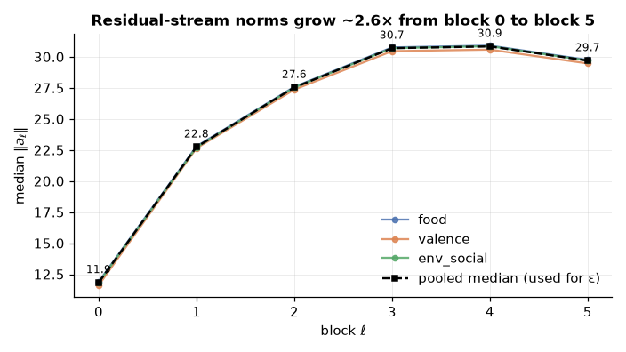
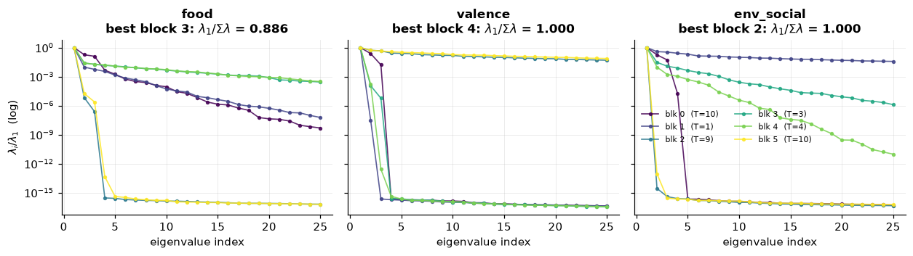
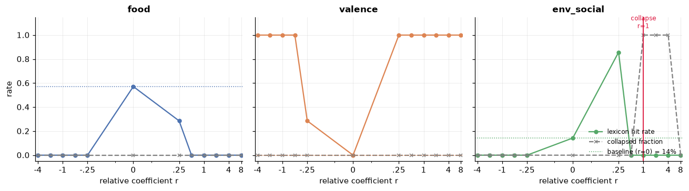
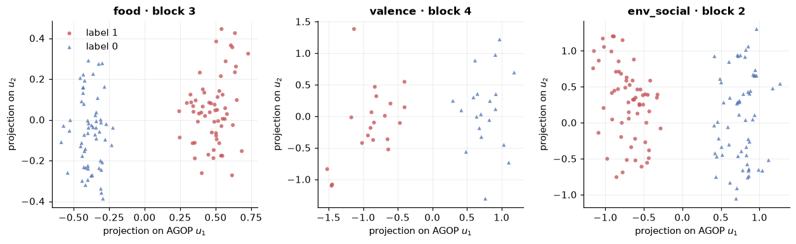
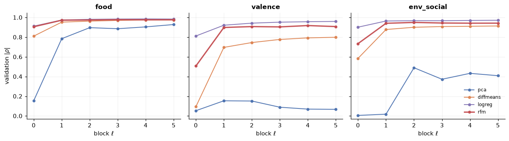

# Tiny Steering: Can Steering Survive on a Fish?

*Leonardo Valadão, Instituto de Matemática e Estatística, Universidade de São Paulo*

Beaglehole et al., in *Toward Universal Steering and Monitoring of AI Models* ([arXiv:2502.03708](https://arxiv.org/abs/2502.03708)), claim that the concepts a Large Language Model "knows" are in fact linear directions in the model's activation space, that these directions can be extracted with feature-learning algorithms such as the Recursive Feature Machine (hereafter RFM), and that, once extracted, one may **steer** the model, that is, push its outputs toward or away from the concept by purely linear computations, or **monitor** the presence of that concept by reading the activations. These claims are established over Llama-class models with 8 to 90 billion parameters, and it is therefore reasonable to ask whether they endure on a model as small as 9 million.

Note that a single checkpoint cannot say how the machinery scales, since that would require a ladder of model sizes, but it can say whether the mechanism survives at the bottom of the range on its own merits, and a negative answer there would bound the whole claim. This post reports a controlled replication of RFM extraction, additive steering, AGOP-eigenvector probing and the baseline comparison, on GuppyLM, a fish-themed model of approximately 8.73M parameters. In short, the reading of concepts transfers intact, the writing of them transfers as a mechanism and yet not as a capability, and the baseline comparison is only partly testable at this scale.

## The machinery

Let a transformer language model be composed of `L` blocks, so that, for a prompt `X`, block `ℓ` has activations `A_ℓ(X)` of shape `t × k`, where `t` is the sequence length and `k` the hidden dimension. As in Beaglehole et al., the feature associated with a prompt is the last real token row of each block output, `a_ℓ` in `R^k`, and for each concept we gather `n` labelled prompts, where `y` in `{0,1}` records the presence of the concept. Note that extracting a concept vector requires no generated text at all, only (prompt, label) pairs and one forward pass each, which is what makes the data collection cheap.

The RFM of Radhakrishnan et al. can be read, informally, as a supervised and nonlinear counterpart to Principal Component Analysis (hereafter PCA), in the sense that, where PCA returns the directions of greatest *variance* in the data, RFM returns the directions to which a fitted *predictor* is most sensitive, via the Average Gradient Outer Product (hereafter AGOP). The predictor is a kernel ridge regression with a Mahalanobis-Laplace kernel `K_M(x,z) = exp(−(1/σ)·sqrt((x−z)ᵀM(x−z)))`, parametrized by a positive semidefinite `M` with bandwidth `σ`, and the iteration starts at `M₀ = I` and alternates two steps, firstly fitting the regression and secondly recomputing `M` as the average outer product of the predictor's mean-centred input-gradients.

After `T` iterations the concept vector `v` is the top eigenvector of `M_T` with unit norm, oriented by the sign of the Pearson correlation between the projections and the labels, so that a positive projection means "more concept". We steer by adding `ε·v_ℓ` to every token row of the output of block `ℓ` during the forward pass, the sign of `ε` carrying the direction of the intervention. For monitoring we keep instead the top `p` eigenvectors per block, training a classifier on the projections onto them. RFM is compared against PCA, difference-in-means and logistic regression under the same sign rule, so that the comparison is one of directions alone.

## The fish, and why absolute coefficients do not port

GuppyLM is a deliberately tiny, open-source and character-driven language model, with approximately 8.73M parameters over 6 transformer blocks of hidden dimension 384, a vocabulary capacity of 4096, and roughly 60k rows of training data spanning 60 templated conversational categories such as food, weather, greetings and moods. It is a good testbed precisely because it is small enough to be fully inspectable while still a real instruction-tuned transformer. Those 60 categories are the only concepts it can plausibly represent, given that they are the whole of its training distribution, so we restrict this work to them.

One convenient consequence of the small scale is that the per-block activation norms can simply be measured, and the median over the cached activations runs 11.9, 22.8, 27.6, 30.7, 30.9 and 29.7 from block 0 to block 5, a roughly 2.6-fold rise peaking at block 4. It is possible to see that the three concepts agree almost exactly on that profile, so the median is a safe scale to normalise by. Consequently a fixed absolute perturbation is a nudge at block 5 and a wrecking ball at block 0, which is exactly why the coefficients of Beaglehole et al. cannot be copied over.

We therefore set `ε_ℓ = r · median_i ‖a_ℓ^(i)‖₂`, and since the concept vector has unit norm, the relative coefficient `r` is exactly the perturbation size as a fraction of the typical residual-stream norm at that block. It is `r`, and not `ε`, that ports across models, and this is the one methodological consequence of this work portable to any scale.

## Concepts, and the harness

For each of the 6 blocks we register forward hooks and extract the last non-pad token row per prompt, having checked the harness for determinism and for padding invariance, which we verified to the order of `7 × 10⁻⁷`. Because the raw user inputs are heavily templated, with only 4 to 34 unique strings per category, we use the full ChatML exchange, the user turn together with GuppyLM's response, as the prompt. On those we build three binary concepts as contrasts between groups of categories, namely `food` (food and taste against weather, seasons and music), `valence` (happy, excited and love against scared, fear and tired) and `env_social` (water, filter and algae against greetings, farewells and loneliness). Each is class-balanced and split 60/20/20 over *unique* strings, giving 360/120/120 examples for the first and third and 120/40/40 for `valence`. We also gate the implementation on a synthetic recovery test, recovering a planted direction `u` in `R^384` from 1,000 points at `|cos(v,u)| = 0.9528`, against a pre-declared criterion of 0.90.

## Extraction: the reading half holds

Running RFM for the concept extraction, we obtain strong linear separability at every block except the earliest. The validation absolute Pearson correlation between the projection and the label reaches 0.978 on `food` at block 3, 0.918 on `valence` at block 4 and 0.950 on `env_social` at block 2, while block 0 sits at 0.906, 0.507 and 0.735. Note that block 0 is consistently weaker, which suggests that one block of attention and MLP is not enough to build the feature. The concept `valence` is the weak one throughout, and that is itself a finding, since the mechanism does not report equal success on every concept it is handed, which is what one wants from a measurement rather than from a demonstration.

We also studied how rank-1 the concepts are, using the fraction of spectral mass carried by the top direction, which at each concept's best block is 0.886, 1.000 and 1.000, so that there the concept really is a single direction. The more interesting observation, however, is that the two properties come apart, since `valence` at block 2 has a thoroughly non-degenerate `M`, at 0.186, and still reaches a validation correlation of 0.908, essentially matching the rank-1 solution of block 4 at 0.918. We conclude, therefore, that the concentration of the AGOP spectrum is not a prerequisite for the top eigenvector being a good concept direction, since it is recoverable well before `M` has finished collapsing onto it.

## Steering: a mechanism without the capability

Sweeping `r` over twelve values from −4 to +8 against the probe prompt "How are you doing today?", the intervention unmistakably works, and it is unmistakably blunt. The baseline output is *"i'm a little fish. i am small but i have opinions. mostly about food."*, while `env_social` at `r = +0.25` gives *"if can breathe can if breathe can if if i breathe breathe more breathe if…"*. A direction fitted to (prompt, label) pairs, which never saw a single generation, drags the output onto tank-and-water vocabulary from a prompt that mentions no such thing, so that the causal claim replicates. However, if one reads the text rather than the keywords, what is there is repetitive and barely grammatical vocabulary drift, and not a fluent fish talking about its tank.

Scoring the steers over 7 neutral probe prompts by lexicon hit rate, the three concepts tell different stories, and two of the three curves are measuring the metric rather than the model. Only `env_social` behaves as Beaglehole et al. would predict, going from a baseline of 14% to 86% at `r = +0.25` and then collapsing, with 7 of 7 generations degenerate at `r = +1, +2, +4`. The concept `food` fails instructively, since its baseline is already 57%, because a fish whose entire personality is thinking about food mentions food unprompted, and steering cannot add a concept already saturated, so it only breaks the sentences that carried it and the hit rate goes *down*, to 29%. That drop is not even a matter of fluency, since the word dominating those generations is *palate*, with 56 occurrences across seven outputs, which is squarely on-concept and simply absent from the thirteen-word lexicon.

The concept `valence` reports 100% at `r = ±0.5` and beyond, in both directions, and that is not symmetric steering, it is the scalar metric discarding a sign it did in fact record. Its lexicon spans both poles, so that a push either way scores a hit, and yet the words separate cleanly, since every negative `r ≤ −0.5` fires *hide* in 7 generations out of 7 and every positive `r ≥ +0.25` fires *excited* in 7 out of 7, with no crossover. The hit *rate* is sign-blind, the hits are not, and this is bidirectional evidence that does not come from the probe.

The second metric, in the absence of a GPT-4o judge at this scale, feeds the generated text back through the model and reads the concept probability given by the monitoring probe. Under it, all three concepts reach a 100% success rate at `r = +0.25`, against baselines of 71.4%, 71.4% and 28.6%. The activations did move, however, and it was we who moved them, so this metric is partially circular, the probe reading the top AGOP eigenvectors while the steering vector is itself the top AGOP eigenvector. What the probe cannot notice is that the sentence carrying that direction stopped being a sentence, and so the 100% figure is not independent evidence.

## Monitoring: a perfect score, reported as a ceiling

Using the top 3 AGOP eigenvectors per block, each prompt becomes a projection vector in `R^18`, a 128-fold compression of the raw activations. A logistic-regression probe trained on those features reaches a test AUROC of 1.000 for all three concepts, and even a single feature suffices, since the first AGOP eigenvector alone reaches 1.000 unaided on all three.

The separation is visible before any classifier is fitted, as the projection of the test split onto the first two eigenvectors already splits the two clouds by the horizontal axis alone. Note, however, that a ceiling is not the same thing as a strong result. Several properties make this an easy setup, since the concepts are the model's *own* training categories, the test splits are small, the classes are drawn from disjoint groups, and, because a prompt is a complete exchange containing GuppyLM's own answer, the probe reads a text already stating its topic lexically. A perfect score says the read-out mechanism is intact at 8.7M parameters, but it says nothing about a genuinely hard concept, because none was presented.

## Baselines: RFM beats PCA, and ties everything else

We ran PCA, difference-in-means, logistic regression and RFM through the same pipeline, splits, probe and success threshold. The separation predicted by Beaglehole et al. does appear, but only against PCA, and only on the two harder concepts, since PCA collapses to a validation correlation of 0.154 on `valence` against RFM's 0.918 and manages 0.490 on `env_social` against 0.950.

The reason is structural, for PCA takes the top direction of variance in the difference matrix, and variance is not the class boundary, so that when two classes differ subtly but each has plenty of internal spread, the top principal component tracks the spread. The supervised methods stay much closer to one another, and note that logistic regression actually edges RFM out on all three concepts, at 0.986, 0.960 and 0.972. On monitoring AUROC the picture is the same, with the three supervised methods all at 1.000 while PCA falls to 0.7425 and 0.8992, and stripping RFM to one direction per block still scores 1.000, so that the extra eigenvectors were never carrying the result.

The steering comparison, in contrast, does not rank the methods at all. The raw table reports 100% success for all four, which reads like a four-way tie but is a broken measurement. Under negative steering on `food` PCA scores 1.000 at `r = −2` and the other two baselines also clear the threshold, so that they are credited with "success" for steering in the wrong direction. Both defects belong to the metric rather than to the methods, namely that the probe is built from the RFM eigenbasis and need not respond antisymmetrically to someone else's direction, and that success is a disjunction, "probe above 0.5 *or* lexicon hit".

Note that this is not a failure to replicate, and it is what the reasoning of Beaglehole et al. itself predicts, since RFM's advantage should appear where the class boundary is neither the direction of greatest variance nor a simple mean shift, and three in-domain distinctions in a fish chatbot are not that test.

## What holds, and what does not

Steering is where the single claim of Beaglehole et al. turns out to be two claims, and only one survives, since the direction does causally move the model and yet does not produce coherent text carrying the concept. It appears an 8.7M-parameter model has too little slack to absorb a perturbation large enough to matter, and a second contribution is plausible, namely that the vectors are fitted on the last token of a *complete* exchange while steering writes them into every position of a *partial* one.

Every result above is bounded by the setting in which it was obtained. The concepts are in-domain training categories, and nothing here transfers to abstract or safety-relevant properties. Both automatic judges are unreliable in known and opposite ways, since the probe reads the same eigenbasis the steering vector comes from and cannot see fluency, while the lexicon is saturated on `food` and misses on-concept words such as *palate*. Measuring steering, and not performing it, was the hard part at this scale, and the small samples wash out the differences between the supervised extractors.

To sustain the further claims of Beaglehole et al., namely the scaling of steerability with model size, the advantage of RFM on hard concepts and the real monitoring benchmarks such as FAVABENCH and HaluEval, we require infrastructure that a single checkpoint cannot provide. We shall therefore take a Pythia model ladder as a follow-on plan, so as to read steerability directly against scale. The main question there is whether the ladder begins to produce fluent text carrying the concept rather than vocabulary drift, and at which size it begins to do so.

In conclusion, the machinery of Beaglehole et al. appears not to require a large model in order to function, but only in order to be worth using, and it is the distance between those two statements that a single tiny checkpoint is able to measure. Here we have discussed one model, one family of in-domain concepts and two imperfect judges, and much more is yet to be discussed, particularly the same pipeline on concepts that a model of this size does not already state lexically in its own output.
