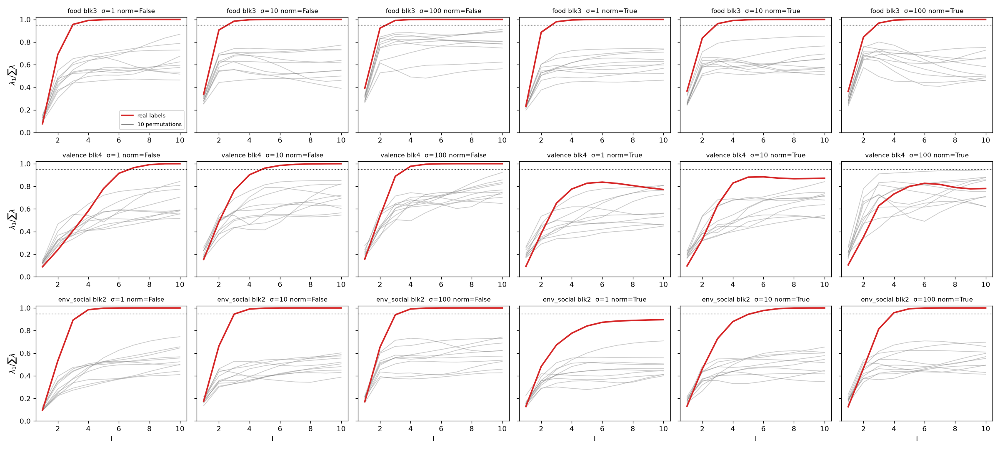

# Check I — Does a shuffled-label control also give $\lambda_1/\sum\lambda \ge 0.95$?

Revision of 2026-10-02. Notebook: `I-shuffled-label-control.ipynb`.
Tables: `I-shuffled-label-control_regime{A,B}.csv` and `I-shuffled-label-control_rho_baselines.csv`.
Figure: `I-shuffled-label-control_share_vs_T.png`.
Everything runs on the cached activations in `rfm_guppy/cache/`, so no new model inference
was needed.

## Short answer

**No.** The shuffled labels never reach the values that the write-up calls "rank-1". There are
9 cells (concept × block) where $s_{\text{real}} \ge 0.95$. In
every one of them, $s_{\text{real}}$ is larger than all 100 shuffled values computed with the
same hyperparameters. In 1,800 shuffled fits, a value $\ge 0.95$ appears only 3 times. Under
the criterion fixed in advance, the hypothesis "the concentration is a label-free artifact of
the RFM iteration" is **refuted for every cell the paper describes as single-direction**.

Two qualifications matter more than the yes/no answer:

1. **The null hypothesis is not near zero.** With labels that carry no concept, RFM still
   puts a median of **0.40–0.76** of the spectral mass on $\lambda_1$. An isotropic matrix
   would give $1/384 \approx 0.003$. A share of 0.8–0.9 is therefore *not* evidence of a
   single direction. Only values close to 1 separate from noise.
2. **This control exposed a second, unplanned problem, with validation $|\rho|$ on `food`
   (Section 5).** A direction computed with *no labels at all*, the top principal component
   of the activations, already reaches val $|\rho| = 0.96$ on `food`. So most of the headline
   0.978 is available without supervision.

## 1. The object being tested

For a concept $c$ and block $\ell \in \{0,\dots,5\}$, let $Z_\ell \in \mathbb{R}^{n\times 384}$
be the last-token residual activations of the training split, and $y \in \{0,1\}^n$ the labels.
Here $n = 360$ for `food` and `env_social` and $n = 120$ for `valence`, always balanced.
RFM with hyperparameters $h = (\sigma, T, \text{normalize})$ returns the AGOP $M_T(Z_\ell, y; h)
\succeq 0$, with eigenvalues $\lambda_1 \ge \dots \ge \lambda_{384} \ge 0$. The statistic is

$$
s(Z_\ell, y; h) \;=\; \frac{\lambda_1(M_T)}{\sum_{j=1}^{384}\lambda_j(M_T)} \in \Big[\tfrac{1}{384},\,1\Big].
$$

The write-up reads $s \approx 1$ as "the concept is a single direction at block $\ell$".
That reading only makes sense if $s$ depends on $y$. If RFM drives any labelling toward
rank 1, the statistic is a property of the algorithm and says nothing about the concept.

## 2. Design

**Null distribution.** Let $\pi$ be a uniformly random permutation of $\{1,\dots,n\}$. Then
$y^\pi$ has the same class counts as $y$, but the association between labels and activations
is destroyed. We compare $s_{\text{real}} = s(Z_\ell, y; h)$ with
$s^{(b)}_{\text{shuf}} = s(Z_\ell, y^{\pi_b}; h)$ in three regimes:

| Regime | Hyperparameters | Draws per cell | Purpose |
|---|---|---|---|
| **A** | Frozen at the $h^\star$ the real-label sweep selected | $B = 100$ | Clean null for the number reported in the paper |
| **B** | Re-selected by the full sweep ($\sigma\in\{1,10,100\}$, $T=1..10$, normalize $\in\{F,T\}$, max val $|\rho|$ against the *real* val labels) | $B = 20$ | Null for the whole pipeline, including hyperparameter selection |
| **C** | Every $(\sigma, \text{normalize})$, trace over $T = 1..10$ | 10 | Does the collapse occur at the same $(\sigma,T)$ without labels? |

**Falsification criterion (fixed before running).** For each cell, the hypothesis
*"$s$ is concept-informative here"* is refuted if

$$
p \;=\; \frac{1 + \#\{b : s^{(b)}_{\text{shuf}} \ge s_{\text{real}}\}}{1 + B} \;\ge\; 0.05
\qquad\text{or}\qquad
\frac{1}{B}\#\{b : s^{(b)}_{\text{shuf}} \ge 0.95\} \;\ge\; 0.05 .
$$

**Reproduction gate.** Before any control ran, the notebook recomputes $s_{\text{real}}$ and
$v_\ell$ at $h^\star$ and asserts that they match the cached `lam1_share` to $10^{-4}$ and the
cached `v_per_block` to $|\cos| > 0.999$. All 18 cells passed.

## 3. Results

### Regime A — frozen hyperparameters, $B = 100$

| concept | blk | $\sigma$ | $T$ | $s_{\text{real}}$ | $s_{\text{shuf}}$ median [q05, q95] | max | $P(s_{\text{shuf}}\ge .95)$ | $p$ | above noise? |
|---|---|---|---|---|---|---|---|---|---|
| food | 0 | 10 | 3 | 0.761 | 0.450 [0.365, 0.553] | 0.588 | 0.00 | 0.010 | yes |
| food | 1 | 1 | 3 | **0.979** | 0.604 [0.458, 0.719] | 0.783 | 0.00 | 0.010 | yes |
| food | 2 | 1 | 8 | **1.000** | 0.576 [0.420, 0.752] | 0.827 | 0.00 | 0.010 | yes |
| food | 3 | 1 | 2 | 0.886 | 0.523 [0.377, 0.637] | 0.680 | 0.00 | 0.010 | yes |
| food | 4 | 1 | 2 | 0.884 | 0.500 [0.376, 0.606] | 0.686 | 0.00 | 0.010 | yes |
| food | 5 | 1 | 8 | **1.000** | 0.562 [0.389, 0.719] | 0.848 | 0.00 | 0.010 | yes |
| valence | 0 | 10 | 10 | 0.797 | 0.756 [0.560, 0.932] | 0.988 | 0.02 | 0.347 | **no** |
| valence | 1 | 10 | 10 | **1.000** | 0.679 [0.503, 0.889] | 0.960 | 0.01 | 0.010 | yes |
| valence | 2 | 100 | 1 | 0.186 | 0.207 [0.175, 0.251] | 0.281 | 0.00 | 0.762 | **no** |
| valence | 3 | 10 | 10 | **1.000** | 0.655 [0.488, 0.890] | 0.943 | 0.00 | 0.010 | yes |
| valence | 4 | 10 | 10 | **1.000** | 0.677 [0.505, 0.874] | 0.950 | 0.00 | 0.010 | yes |
| valence | 5 | 100 | 1 | 0.147 | 0.205 [0.161, 0.246] | 0.269 | 0.00 | 0.990 | **no** |
| env_social | 0 | 100 | 10 | 0.813 | 0.675 [0.471, 0.819] | 0.871 | 0.00 | 0.069 | **no** |
| env_social | 1 | 100 | 1 | 0.222 | 0.198 [0.160, 0.232] | 0.252 | 0.00 | 0.168 | **no** |
| env_social | 2 | 10 | 9 | **1.000** | 0.484 [0.370, 0.630] | 0.693 | 0.00 | 0.010 | yes |
| env_social | 3 | 10 | 3 | 0.943 | 0.428 [0.336, 0.543] | 0.583 | 0.00 | 0.010 | yes |
| env_social | 4 | 10 | 4 | **0.987** | 0.436 [0.342, 0.567] | 0.664 | 0.00 | 0.010 | yes |
| env_social | 5 | 10 | 10 | **1.000** | 0.521 [0.379, 0.679] | 0.769 | 0.00 | 0.010 | yes |

Bold marks $s_{\text{real}} \ge 0.95$. With $B = 100$, the smallest attainable $p$ is
$1/101 \approx 0.0099$, so $p = 0.010$ means "larger than all 100 shuffled values".

**Reading.**
- **All 9 cells with $s_{\text{real}} \ge 0.95$ are above noise.** Their shuffled maxima are at most
  0.960 (`valence` block 1, a single draw). `valence` is closest to the threshold. It has the
  smallest $n$ (120 for $k = 384$) and runs with $T = 10$, so the kernel ridge regression
  interpolates noise more easily.
- **All 5 cells that are not above noise are ones the paper already treats as weak or uncollapsed.** Three
  sit at the broad-spectrum setting $(\sigma = 100, T = 1)$ (`valence` 2 and 5,
  `env_social` 1), and two are block 0, where val $|\rho|$ is lowest (`valence` 0 and
  `env_social` 0). For these cells the test says: *their share is indistinguishable
  from what random labels give.* That is consistent with the paper's description of them as
  "non-degenerate", and it adds that the low value carries no concept information either.
- **The shuffled directions are not the concept direction.** The median
  $|\cos(u_{\text{shuf}}, v_{\text{real}})|$ is 0.06–0.30 (column `cos` in the CSV). Each
  shuffled run therefore collapses, partially, onto *some other* direction.

### Regime B — full pipeline re-run on shuffled train labels, $B = 20$

The same 9 high cells are above noise. No shuffled run reaches 0.95, and the largest shuffled share
among those cells is 0.875. With $B = 20$, the smallest attainable $p$ is
$1/21 \approx 0.048$, so these cells pass the $p < 0.05$ bar only at the edge of what the
test can resolve. **Regime A is the decisive test. B is a check that hyperparameter
selection does not manufacture the effect.**

Four cells are not above noise: `valence` 0, 2, 5 and `env_social` 1. In B, the shuffled median
share is *higher* than the real one at `valence` 2 and 5 and `env_social` 1 (e.g. 0.52
vs 0.19). The cause is the selection step: under shuffled labels, the sweep moves away
from $(\sigma = 100, T = 1)$ to larger $T$, which concentrates $M$ regardless of the labels.

### Regime C — share as a function of $(\sigma, T)$

Each concept is shown at its best block (food 3, valence 4, env_social 2). Red is the real
labels and gray is 10 permutations.

- **With normalize = False (left three columns), the result is clean.** At every $\sigma$,
  the real labels pass 0.95 by $T = 3$–$7$, while the shuffled curves level off at about
  0.4–0.9 and never cross. At a fixed $(\sigma, T)$, the labels are what produces the
  collapse.
- **With normalize = True, `valence` does not separate from the null.** The real curve
  levels off at 0.78–0.88, inside the gray band. `env_social` with $\sigma = 1$,
  normalize = True also stops at 0.90. These settings were not selected by the sweep, so no
  reported number depends on them. But they show the statistic is not label-driven under
  *every* setting.
- **This refines a claim in the paper.** The paper says the sweep "cannot attribute the
  collapse to either [bandwidth or iteration count] alone". That remains true. Regime C
  adds a question the paper did not ask: *at a fixed $(\sigma, T)$, does the collapse
  depend on the labels?* The answer is yes, for the settings that were actually selected.

## 4. Caveats on the test itself

1. **Multiple comparisons.** There are 18 cells. A Bonferroni threshold of
   $0.05/18 \approx 0.0028$ is below the smallest $p$ that $B = 100$ can produce (0.0099).
   So Regime A **cannot** claim family-wise significance, only that each high cell exceeds
   all 100 null values. The margins are large (e.g. `env_social` 2: 1.000 vs a null max of
   0.693), so this is a limit of resolution, not a sign of weakness. **Minimal fix:**
   $B = 1000$ on the 9 high cells only, about **0.5 h** of compute and **0.25 h** of
   reading.
2. **Only the training labels are permuted.** The activations, the splits and the
   centring are unchanged. That is the right null for "do the labels drive $s$?". It is not
   a null for "would different prompts give the same $s$?".
3. **One permutation scheme.** The permutation is uniform over all training items. A
   within-category permutation would be stricter, because it keeps the topic structure and
   shuffles only within topics. It was not run.

## 5. Unplanned finding: val $|\rho|$ on `food` is mostly label-free

Regime A records the val $|\rho|$ of each shuffled-label direction. On `food` it came out at
a median of **0.85–0.88**, close to the real 0.97–0.98. To calibrate this, the notebook
(Section E) computes val $|\rho|$ for directions that use no labels, or only the class means:

| concept | blk | RFM | RFM, shuffled labels (median) | random unit vector: median / q95 | **PC1 of activations (no labels)** | DiffMeans |
|---|---|---|---|---|---|---|
| food | 3 | 0.978 | 0.879 | 0.380 / 0.764 | **0.959** | 0.970 |
| food | 5 | 0.977 | 0.856 | 0.394 / 0.773 | **0.968** | 0.975 |
| valence | 4 | 0.918 | 0.251 | 0.183 / 0.487 | 0.412 | 0.793 |
| env_social | 2 | 0.950 | 0.378 | 0.253 / 0.589 | 0.815 | 0.901 |

The full per-block table is in `I-shuffled-label-control_rho_baselines.csv`.

**What this means.**
- **`food`:** the food-vs-other split is the **dominant variance axis** of the activations.
  The unsupervised top principal component already reaches 0.94–0.97 on blocks 1–5. RFM adds
  about 0.01–0.03 on top of that. The current conclusion sentence, "labels alone drive the
  validation $|\rho|$ as high as 0.978", is technically true but misleading, because no
  labels at all already give 0.959.
- **`valence`** is where supervision clearly matters: 0.92 against a PC1 of 0.41 and a
  shuffled-label value of 0.25. **It is the best evidence that RFM finds a concept rather
  than the main axis of variation.**
- **`env_social`** is in between, with PC1 at 0.70–0.85.
- **Random directions are not near zero either.** Their q95 is 0.49–0.77. The class means
  are far apart in activation space, and $n_{\text{val}}$ is small (40 for `valence`), so
  even a random projection correlates noticeably with the label.
- **Consistent with Check II:** the corrected (uncentred) PCA baseline also shows "no gap on
  food" (see `II-PCA-baseline.md`).

This finding does **not** affect the $\lambda_1$ question. It affects how val $|\rho|$
should be presented.

## 6. What to change in the write-up (drop-in text)

**(a) `03_replication.tex`, rank-1 paragraph.** After "...so that there the concept
really is a single direction.", insert:

> A permutation control shows that this concentration is label-driven and not an artifact
> of the iteration. With the training labels shuffled and the selected $(\sigma, T)$ held
> fixed, RFM never exceeds $\lambda_1/\sum_j\lambda_j = 0.96$ in 100 draws at any block
> where the real labels give $\ge 0.95$. However, the null is far from zero: with random
> labels, the median share is 0.40–0.76. Values of 0.8–0.9 therefore do not indicate a
> single direction, and only values near 1 separate from noise.

**(b) `03_replication.tex`, conclusion paragraph (around line 476).** Replace "on real
concepts, labels alone drive the validation $|\rho|$ as high as 0.978" with:

> on real concepts the validation $|\rho|$ reaches 0.978 (`food`), although on `food` the
> unsupervised top principal component of the activations already reaches 0.959, so that
> supervision adds little there. The case where it matters is `valence`, where RFM reaches
> 0.918 against 0.412 for the top principal component.

**(c) `results/REPORT.md`, line 214.** The claim "Concepts are near-perfectly rank-1
(λ1/Σλ ≈ 1.0)" should name the cells and the control: "9 of 18 concept × block cells reach
λ1/Σλ ≥ 0.95, and in each of them the value exceeds 100/100 shuffled-label draws (Check I)".

## 7. Verdict

| Claim | Status |
|---|---|
| $\lambda_1/\sum\lambda \approx 1$ at the selected HP reflects the labels, not the algorithm | **Holds** for all 9 cells with $s \ge 0.95$ (100/100 draws below in A; 20/20 in B) |
| Moderate shares (0.76–0.89) indicate a single direction | **Does not hold.** The null median is 0.40–0.76, so these mean "above noise", not "rank-1" |
| Low shares (0.15–0.22) at $(\sigma = 100, T = 1)$ | Indistinguishable from random labels. Consistent with the paper's "non-degenerate" reading |
| The collapse is label-driven at every $(\sigma, T, \text{normalize})$ | **Does not hold** for `valence` with normalize = True (not a selected setting) |
| "Labels alone drive val $|\rho|$ to 0.978" | **Misleading.** Label-free PC1 reaches 0.959 on `food` |

**Optional follow-ups, each with a minimal version:**
- $B = 1000$ for the 9 high cells, to reach family-wise significance: **≈0.75 h**.
- Within-category permutation null: **≈1 h**. The minimal version is `food` only.
- Apply the text changes (a)–(c): **≈0.5 h**.
